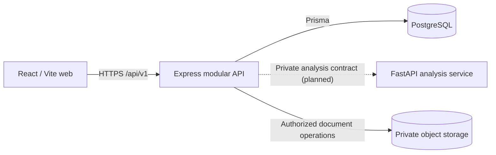

# Architecture

## Runtime and ownership

- **Web** lives in `apps/web`. React, TypeScript, Vite, Tailwind CSS 4, and locally owned shadcn/ui primitives support the public landing page, identity pages, and role workspaces. The browser uses the Express API with a session cookie.
- **API** lives in `apps/api`. Express owns authorization, transactional workflows, persistence, and audit events. Keep one deployable API until scale or operational isolation justifies splitting a module.
- **Data** uses PostgreSQL and Prisma. The initial migration creates `institutions`. Model foreign keys, unique constraints and projections as each feature lands. Application uniqueness will cover student and drive. Application transitions and their audit records will commit together.
- **AI** lives in `services/ai`. FastAPI has a health endpoint and no database connection or provider in Phase 2. Later the API will authorize requests, minimize inputs, invoke analysis over an internal channel and persist authorized results with provenance. Production service authentication and network isolation must precede real-data traffic.

## API module boundaries

| Module                   | Owns                                                                                         | Collaborates with                                                             |
| ------------------------ | -------------------------------------------------------------------------------------------- | ----------------------------------------------------------------------------- |
| Identity and access      | Identity, sessions, institution memberships, invitations, scoped role policy                 | Supplies identity and scope to protected modules                              |
| Student records          | Academic profiles, verification status, resume metadata and access policy                    | Supplies eligibility facts and authorized resume versions                     |
| Employers and drives     | Organizations, recruiter assignments, postings, approval, eligibility rules                  | Supplies published drives and rule versions to applications                   |
| Applications             | Eligibility decisions, application uniqueness, candidate stages, offer and withdrawal events | Reads approved rules and verified records. Drives notifications and reporting |
| Placement operations     | Campus policy, outcome reporting, restricted exports                                         | Reads application events and institution membership                           |
| Audit and administration | Institution configuration, administrative events, retention operations                       | Receives audit events from protected mutations                                |
| AI orchestration         | Analysis request, status, provenance, failure classification                                 | Calls FastAPI privately and attaches output to authorized entities            |
| Notifications            | Email delivery interface and future delivery history                                         | Uses a local development inbox or configurable SMTP adapter                   |

Use HTTP JSON under `/api/v1` for public business contracts. Scope collection endpoints and resource lookups by institution and ownership before returning data. Standardize pagination, error envelopes, UTC timestamps and concurrency semantics before exposing business endpoints. Reserve `/health` for process liveness and API `/ready` for PostgreSQL connectivity. Readiness does not validate migration history. Compose applies migrations before starting Express.

## Environments

Compose runs the local services on loopback and uses a named Postgres volume. Production will serve built web assets over HTTPS, route the API through a controlled ingress, use managed PostgreSQL and approved private document storage, and expose the AI service only over private networking. Run migrations as a deployment task separate from production API startup. Define backup recovery, runtime secret injection, monitoring and trace correlation before pilot deployment.

## Reference assessment

Reviewed the reference at commit `2d2baa4f53abf38df2aa30905d048bae97ee4f61`, including its README, Express route assembly, Compose topology and Python analysis module structure. CampusAI independently implements the separation between browser, role-oriented API modules and Python analysis. CampusAI uses relational persistence, explicit migration ownership and a small static landing page. No reference source, assets, sample outcomes or credentials were copied. [Reference snapshot](https://github.com/sai46-ai/AI-Campus-Recruitment-System/tree/2d2baa4f53abf38df2aa30905d048bae97ee4f61)

## Phase 2 runtime

Identity validates the session and resolves the current institution membership. Institution modules apply role and resource policies. Documents use private S3-compatible storage with no public URLs and a compensation ticket when object persistence crosses the database transaction boundary. Compose uses Versity Gateway and Mailpit. Existing Phase 1 liveness and readiness endpoints remain available.

[Authentication](AUTHENTICATION.md) · [Permissions](PERMISSIONS.md) · [Entity relationships](ER_DIAGRAM.md) · [API](API.md)
