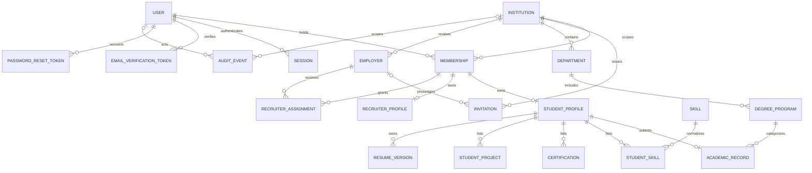

# Phase 2 entity relationships

The Phase 1 institution and migration remain intact. Composite foreign keys enforce equal institution IDs between memberships and profiles, departments and programs, students and academic programs, employers and assignments or invitations, and students and resumes. Certification, project and skill joins inherit scope through the profile. The normalized skill vocabulary is shared.

An academic record represents the current revision. Changes to academic facts increment that revision and invalidate verification. An unchanged resubmission preserves verification. Employer and academic decisions store status and review time, with reviewing actors identified in audit events. Audit targets reference heterogeneous resources by ID.

Resume metadata carries a random private object key. A partial unique index allows one active version per student. Deletion timestamps track denial of future access and physical removal. The independent `DocumentCleanup` table holds object keys awaiting upload compensation. A second partial unique index permits one pending invitation per institution and email. Check constraints guard lifecycle combinations and numeric limits.
